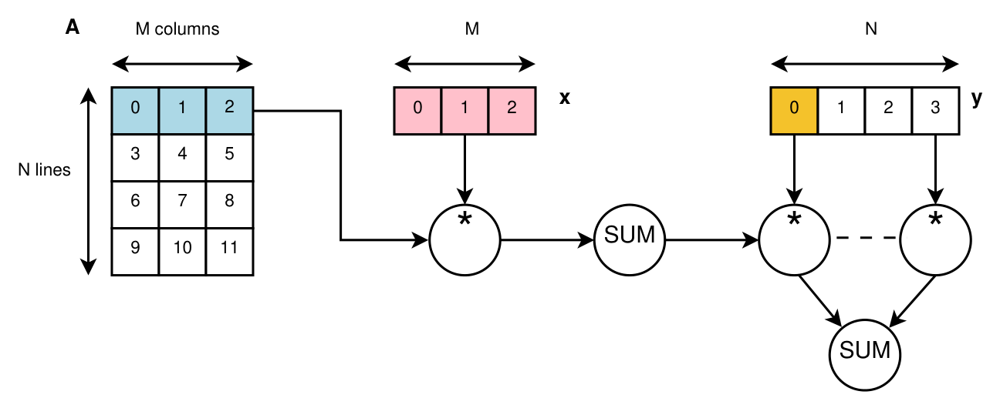
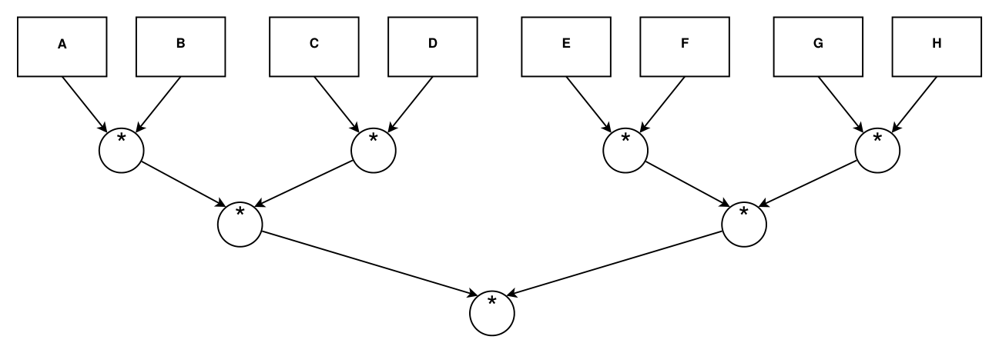

# OpenMP : étude de performance de calculs parallèles

Rapport et code sur la parallélisation avec OpenMP : calcul de π, produit matrice-vecteur (avec SIMD), liste chaînée de Fibonacci (tâches), produit de matrices en `double`, `float` et `half`, et enchaînement de produits de matrices.

Le rapport est le notebook [`rapport_OpenMP.ipynb`](rapport_OpenMP.ipynb). Sa version PDF est [`rapport_OpenMP.pdf`](rapport_OpenMP.pdf).

## Énoncé de départ

Cette section reprend le sujet du TD n°1 (OpenMP) de Jonathan Rouzaud-Cornabas, traduit et adapté en français.

### Consignes

Les versions incomplètes des codes sont disponibles sur Moodle. Deux semaines après la séance pratique, il faut envoyer un rapport (évaluation de performance et courte analyse pour chaque partie) accompagné des codes complétés. L'évaluation de performance et l'analyse comptent autant que le code. Le travail se fait seul ou en binôme (pas plus) et le rapport est noté.

Le sujet contient 5 parties, chacune plus complexe que la précédente. Le minimum demandé est les deux premières parties.

### Méthodologie d'évaluation des performances

1. Modifier la partie des codes qui mesure la performance pour enregistrer la valeur (et de préférence aussi les paramètres, par exemple la taille de la matrice) dans un fichier, par exemple un CSV. Cela facilite l'agrégation des mesures de plusieurs exécutions et évite de recopier les temps à la main dans un tableur, ce qui est une source d'erreurs.
2. Tester avec différents nombres de cœurs (par exemple 1, 2, 4, 8) quand le code est parallélisé avec OpenMP. Il est conseillé d'ajouter un argument à chaque code pour le choisir sans recompiler.
3. Automatiser les exécutions multiples (selon une plage de valeurs pour chaque paramètre).
4. Répéter chaque exécution plusieurs fois (au moins 10 fois).
5. Les figures doivent présenter des valeurs agrégées (moyenne, médiane et/ou écart-type).
6. Le langage de script est libre (bash est le minimum, et un notebook Jupyter est plutôt la bonne façon de faire).
7. Même chose pour les figures (Python avec NumPy et Matplotlib, ou R avec ggplot2, sont de bons choix, et il faut éviter Excel même si cela fonctionne).
8. Toutes les expériences doivent être faites et évaluées sur la même machine.
9. Optionnel : comparer les performances sur une autre machine (voir Moodle pour accéder aux machines de Grid'5000).
10. Optionnel : rendre la démarche reproductible pour faciliter la reproduction du travail, y compris sur une autre machine.

### Partie 1 : calcul de π

Le code séquentiel de départ est `src/1_0_pi_depart.cpp`.

- Question 1.1 : `for` + `critical`
- Question 1.2 : `for` + `atomic`
- Question 1.3 : `for` + `reduction`
- Question 1.4 : découper le tableau en N parties, chaque thread calcule une somme partielle, puis on calcule la somme globale (avec l'une ou toutes les solutions précédentes)
- Question 1.5 : évaluer la performance pour 1 000 000, 100 000 000, 10 000 000 000 et 1 000 000 000 000 pas
- Question 1.6 : tracer des figures de performance
- Question 1.7 : expliquer les performances

### Partie 2 : produit matrice-vecteur

Le code séquentiel à compléter est fourni avec le sujet, la version complétée est `src/2_1_vector.cpp`. La figure 1 décrit l'algorithme (il est aussi en commentaire dans le code).



*Figure 1 : workflow de la partie 2 (produit matrice-vecteur). La matrice A de N lignes et M colonnes est multipliée ligne par ligne par le vecteur x, chaque somme est multipliée par l'élément correspondant du vecteur y, puis tous les résultats sont additionnés.*

- Question 2.1 : compléter le code pour obtenir un code séquentiel fonctionnel
- Question 2.2 : évaluer la performance pour N = 2, 4, 8, 10, 12, 14, 16 et M = 1, 3, 7, 9, 11, 13, 15 (ce sont les exposants de 2 utilisés par le code, la taille vaut 2^N et 2^M)
- Question 2.3 : tracer des figures de performance
- Question 2.4 : expliquer les performances
- Question 2.5 : ajouter le pragma OpenMP
- Question 2.6 : évaluer la performance pour les mêmes valeurs de N et M
- Question 2.7 : tracer des figures de performance
- Question 2.8 : expliquer les performances
- Question 2.9 : ajouter le pragma OpenMP SIMD (sans retirer les pragmas OpenMP classiques)
- Question 2.10 : évaluer la performance pour les mêmes valeurs de N et M
- Question 2.11 : tracer des figures de performance
- Question 2.12 : expliquer les performances

### Partie 3 : Fibonacci et liste chaînée

Le code séquentiel à compléter est fourni avec le sujet, la version complétée est `src/3_1_fib.cpp`.

- Question 3.1 : ajouter le ou les pragmas OpenMP
- Question 3.2 : évaluer la performance pour N = 1000, 4000, 8000, 12000, 18000 et M = 1000, 4000, 8000, 12000, 18000
- Question 3.3 : tracer des figures de performance
- Question 3.4 : expliquer les performances

### Partie 4 : produit de matrices et précision des flottants

Le code séquentiel de départ est `src/4_0_matrix_mul_depart.cpp`.

- Question 4.1 : ajouter le ou les pragmas OpenMP
- Question 4.2 : évaluer la performance pour N = 1000, 4000, 8000, 12000, 18000 et M = 1000, 4000, 8000, 12000, 18000
- Question 4.3 : tracer des figures de performance
- Question 4.4 : expliquer les performances
- Question 4.5 : modifier le code pour passer le type de la matrice de `double` à `float`
- Question 4.6 : évaluer la performance pour les mêmes valeurs de N et M
- Question 4.7 : tracer des figures de performance
- Question 4.8 : expliquer les performances
- Question 4.9 : modifier le code pour passer le type de la matrice de `double` à `half` (inclure `half.hpp`, le type est `half_float::half`)
- Question 4.10 : évaluer la performance pour les mêmes valeurs de N et M
- Question 4.11 : tracer des figures de performance
- Question 4.12 : expliquer les performances

### Partie 5 : enchaînement de produits de matrices

On peut enchaîner plusieurs produits de matrices, par exemple comme dans la figure 2.



*Figure 2 : enchaînement de produits de matrices. Huit matrices (A à H) sont multipliées deux à deux, puis les quatre résultats sont multipliés deux à deux, puis les deux derniers résultats sont multipliés. Cela fait 7 produits répartis sur 3 niveaux.*

- Question 5.1 : proposer une implémentation parallèle de ce workflow en réutilisant le code de la partie précédente
- Question 5.2 : évaluer la performance pour N = 1000, 4000, 8000, 12000, 18000 et M = 1000, 4000, 8000, 12000, 18000
- Question 5.3 : tracer des figures de performance
- Question 5.4 : expliquer les performances

Les grilles de tailles réellement utilisées dans ce dépôt diffèrent de celles du sujet pour les parties 2 (dernière paire exclue), 3, 4 et 5. Les raisons sont expliquées dans les sections 2.2, 3.2, 4.2 et 5.2 du rapport.

## Contenu du dépôt

| Partie | Sujet | Sources (`src/`) |
|---|---|---|
| 1 | Calcul de π : `critical`, `atomic`, `reduction`, découpage manuel | `1_0` à `1_4` |
| 2 | Produit matrice-vecteur : séquentiel, OpenMP, OpenMP + SIMD | `2_1`, `2_5`, `2_9` |
| 3 | Liste chaînée et Fibonacci avec des tâches OpenMP | `3_1` |
| 4 | Produit de matrices en `double`, `float` et `half` | `4_0`, `4_1`, `4_5`, `4_9` |
| 5 | Enchaînement de 7 produits de matrices avec des tâches | `5_1` |

Le premier chiffre des noms de fichiers est la partie du sujet, le second le numéro de la question. Les fichiers `1_0` et `4_0` sont les codes de départ fournis avec le sujet.

## Organisation

```
rapport_OpenMP.ipynb   le rapport (code, mesures, figures, discussions)
rapport_OpenMP.pdf     la version PDF du rapport
src/                      sources C++ et half.hpp
bin/                      exécutables compilés (créé par le notebook)
donnees/mesures.xlsx      toutes les mesures, une feuille par partie
docs/images/              figures de l'énoncé reprises dans ce README
```

## Prérequis

- Windows avec `g++` compatible OpenMP (MinGW-w64). Le notebook utilise la syntaxe Windows (`.exe`, `\`) et n'a pas été testé sur Linux ou macOS.
- Python 3 avec Jupyter (ou VS Code), `pandas`, `numpy`, `matplotlib` et `openpyxl` :

```
pip install -r requirements.txt
```

## Utilisation

1. Ouvrir `rapport_OpenMP.ipynb`.
2. Exécuter les cellules de haut en bas. Le notebook écrit les sources dans `src/`, les compile dans `bin/`, lance les mesures puis trace les figures.

Les mesures déjà présentes dans `donnees/mesures.xlsx` ne sont pas refaites : chaque cellule de lancement ne relance que ce qui manque pour atteindre 10 répétitions par configuration. Avec le classeur fourni, rien n'est donc relancé et les tableaux et figures sont reconstruits en quelques secondes.

Pour tout refaire, supprimer `donnees/mesures.xlsx` avant d'exécuter le notebook. Compter environ 5 heures sur une machine de type i5-10500H (6 cœurs, 8 Go de RAM), et les valeurs obtenues seront différentes de celles du rapport.

## Compilation manuelle

```
g++ -o bin/1_1_pi_critical src/1_1_pi_critical.cpp -fopenmp -O3 -march=native
bin\1_1_pi_critical.exe -N 100000000 -C 4
```

L'option `-C` fixe le nombre de threads. Pour les parties 4 et 5, il faut donner la même valeur à `-N`, `-M` et `-P` (matrices carrées).

## Données

`donnees/mesures.xlsx` contient une feuille par partie :

| Feuille | Colonnes |
|---|---|
| `partie1_pi` | version, nbcore, num_steps, runtime |
| `partie2_vecteur` | version, nbcore, N, M, size_mb, runtime, bandwidth |
| `partie3_fib` | version, nbcore, N, runtime |
| `partie4_matrices` | version, nbcore, N, M, P, runtime, mflops |
| `partie5_chaine` | version, nbcore, N, M, P, runtime, mflops |

Chaque ligne est une exécution. Les programmes écrivent un petit CSV temporaire (`stats*.csv`) que le notebook ajoute au classeur puis supprime.

## Résultats principaux

- Partie 1 : `critical` et `atomic` ralentissent quand on ajoute des threads, alors que `reduction` et le découpage manuel accélèrent (speedup d'environ 4,6 à 8 threads pour 10^10 pas).
- Partie 2 : OpenMP n'est rentable qu'à partir de matrices d'environ 4 Mo. Au-delà, le speedup sature vers 3 (limite de bande passante mémoire). SIMD apporte un gain d'environ 2 à 1 thread.
- Partie 3 : le speedup plafonne autour de 2,3 à cause d'une tâche dominante (le dernier nœud), avec une borne théorique d'environ 2,6.
- Partie 4 : `float` est jusqu'à 2 fois plus rapide que `double`. `half` est de 3 à 10 fois plus lent à 1 thread, car le processeur n'a pas d'instructions de calcul en demi-précision.
- Partie 5 : l'enchaînement par tâches est limité à un speedup d'environ 2 (borne 7/3 par sa structure en trois niveaux).

Les détails, les tableaux et les hypothèses sont dans le rapport.

## Utilisation d'un LLM

Un assistant d'IA a été utilisé pour ce travail. Le détail est donné au début du rapport, dans la section « Utilisation d'un LLM ».

## Licences

- `src/half.hpp` : bibliothèque de Christian Rau (licence MIT).
- Les codes de départ (`1_0`, `4_0`) et l'énoncé viennent du sujet de départ.
